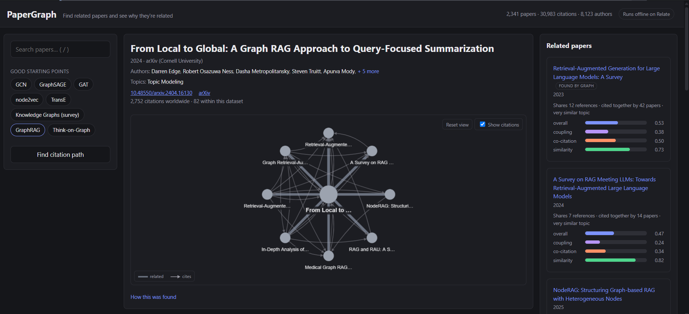
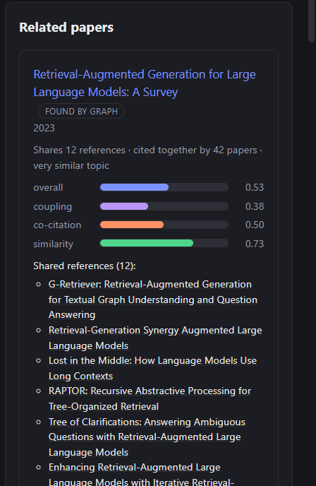
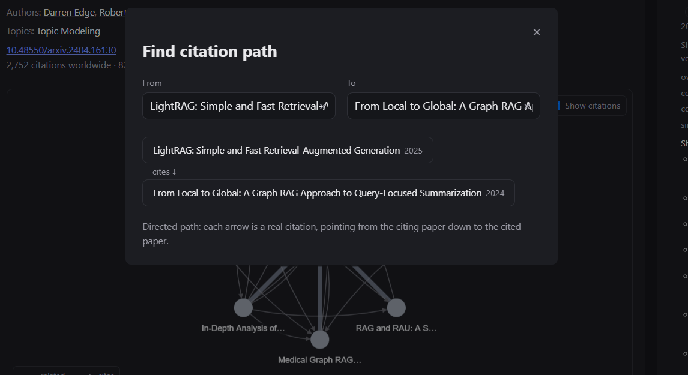
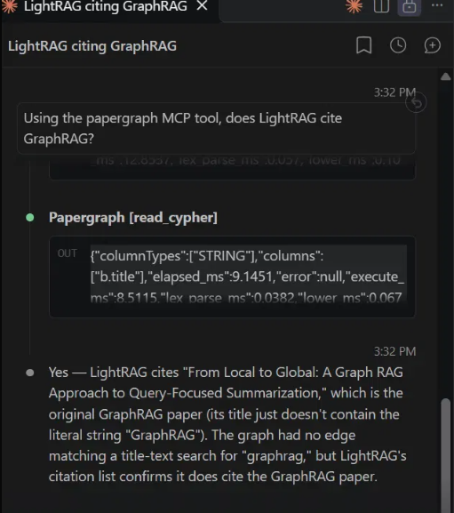

# PaperGraph

Find related research papers and see exactly why they're related, from a real citation graph in an embedded Relate store.



Demo video: <link>

## Use case

Starting a literature review in an unfamiliar area usually means keyword search: you get a list of papers that mention the right words, with no sense of how they actually connect to each other or to the paper you already care about. PaperGraph instead ranks related papers using three clues you can inspect yourself, computed from a real citation graph built from OpenAlex data:

- **Shared references** — two papers that cite the same earlier work.
- **Co-citation** — two papers that a later paper cites together.
- **Topic similarity** — how close their titles and topics are in meaning, from a locally-computed embedding.

Every related-paper result shows all three signals as separate scores, plus the actual shared references and co-citing papers behind them — nothing is a black-box "trust me" ranking. The same graph can also be queried directly by a coding agent over MCP (read-only), so claims like "does paper A cite paper B?" can be checked against the graph itself, not just the UI.

## How it uses Relate

- Mode: single file
- Why this mode: whole graph plus vectors in one file, easy to commit, clone and inspect; built once, read-only at runtime
- What the graph models: Paper, Author, Topic; CITES, AUTHORED, HAS_TOPIC; vector index

The app reads that one file through a dedicated read-only worker thread (Relate connections are tied to the thread that opens them, and only one writer is ever allowed on a store — this app never writes), every query is parameterized Cypher, related-paper candidates come from Relate's native vector search combined with graph signals (bibliographic coupling, co-citation) in one scoring step, and the same store can be served read-only over an MCP server for agent access.

## Setup and run

No API key, no account, no internet connection, and no model download are needed to run the app — it only ever reads the committed `data/papergraph.rl` file.

**Prerequisites:** Python 3.12 (tested). Newer Python versions may not have prebuilt wheels for all dependencies yet. On Windows, use `py -3.12 -m venv .venv` if 3.12 isn't your default.

**Windows (PowerShell)**

```powershell
git clone https://github.com/Kevin29Johnson/PaperGraph
cd PaperGraph
python -m venv .venv
.venv\Scripts\Activate.ps1
pip install -r requirements.txt
python -m uvicorn app.main:app --host 127.0.0.1 --port 8000
```

**macOS / Linux**

```bash
git clone https://github.com/Kevin29Johnson/PaperGraph
cd PaperGraph
python3 -m venv .venv
source .venv/bin/activate
pip install -r requirements.txt
python -m uvicorn app.main:app --host 127.0.0.1 --port 8000
```

Then open **http://localhost:8000**.

## Where the data lives

- `data/papergraph.rl` — the Relate store itself, **56.62 MB**, committed.
- `data/csv/` — the same data as plain CSVs (papers, authors, authored, topics, has_topic, cites, openalex_related), committed, human-readable.
- `data/embeddings.npy` — the precomputed title/topic embedding for every paper (384-dim, L2-normalized), committed.

**Inspect the store with the Relate CLI** (`relate --version` → install from [relatedb.ai/docs](https://relatedb.ai/docs)):

```
relate --database data/papergraph.rl --read-only --mode table "MATCH (p:Paper) RETURN count(p) AS papers"
```

```
+--------+
| papers |
+--------+
| 2341   |
+--------+
```

(The CLI also prints a one-time anonymous-telemetry notice on first run; that's unrelated to the query result above it.)

**Rebuild the store from scratch** (not needed to run the app — only if you want to regenerate the dataset yourself): this needs a free OpenAlex API key in a local `.env` file (`OPENALEX_API_KEY=...`) and the extra ingestion dependencies:

```bash
pip install -r requirements-ingest.txt
python -m ingest.fetch_openalex
python -m ingest.embed
python -m ingest.load
```

`ingest.embed` downloads the embedding model (`all-MiniLM-L6-v2`, about 90 MB) from Hugging Face on its first run; after that it's cached locally.

## Features

- **Search** — live, debounced title search.
- **Related papers with evidence** — ranked list, each with coupling/co-citation/similarity score bars and the actual shared references and co-citing papers behind them, clickable.
- **"Found by graph"** — a badge on related results that citation signals surfaced even though they weren't a close embedding match.
- **Citation path** — shortest path between any two papers; tries both citation directions and reports whichever is actually shorter and real, not just the direction you typed.
- **Author and topic views** — an author's papers and co-authors; the key papers in any topic, ranked.
- **Graph view** — the open paper and its related papers, with real citation edges drawn separately from "related" links.
- **Light/dark** — follows your OS theme automatically.

## Screenshots

**Related-paper evidence** — shared references and co-citing papers behind a score:



**Citation path** — shortest real path between two papers, in either direction:



**An agent querying the graph over MCP**:



## Connect an agent (MCP)

The store can be served read-only over MCP so a coding agent can query the graph directly — see **[docs/MCP.md](docs/MCP.md)** for the serve command, a ready-to-use `.mcp.json`, the schema, and example questions with real Cypher and real results.

## Numbers

2,341 papers · 8,123 authors · 170 topics · 30,983 citation edges · 12,052 authorship edges · 2,337 topic edges.

Query latency (median / p95, measured directly against the store): search 35 / 54 ms, paper lookup 5 / 8 ms, related papers 239 / 344 ms, citation path 1 / 2 ms, topic 66 / 102 ms, author 1 / 3 ms. Full methodology and machine details: **[docs/benchmarks.md](docs/benchmarks.md)**.

## Architecture

Two phases: a one-time ingestion pipeline (OpenAlex → CSVs → embeddings → the committed Relate store) that touches the internet once, and an offline runtime (FastAPI + a single read-only worker thread + a static HTML/CSS/JS frontend) that never does. Full file-by-file breakdown, the graph schema, and a traced example request: **[docs/ARCHITECTURE.md](docs/ARCHITECTURE.md)**.

## Limitations

- Citation data comes from OpenAlex and can be incomplete — for example, OpenAlex's own extracted reference list for the Graph Attention Networks paper doesn't include the GCN paper, even though the published paper cites it. This is a gap in OpenAlex's data, not something this project fills in by hand.
- Some citation paths appear to go from an older paper to a newer one. This usually reflects the citing paper's record being an updated version (e.g. a revised preprint) that cites newer work.
- Topic labels are OpenAlex's own primary-topic classification for each paper, not computed here.
- One originally-planned seed paper (the GIN paper, "How Powerful are Graph Neural Networks?") was dropped during ingestion because OpenAlex's only record for it is filed under an unrelated, incorrect title — there was no correctly-titled record to use instead.

## Prior art

Tools like Connected Papers already visualize related-paper graphs. PaperGraph's additions: explainable, inspectable scores (not just a similarity graph), a single embedded offline store with no server or account needed, and read-only agent access to the same graph over MCP.

## Tested with

Python 3.12, relate-db 1.0.1, Relate CLI 1.2.0, Windows 11.

## Disclosures

- **Relate features used**: the Python library (`relate-db`), single-file (`.rl`) storage, parameterized Cypher, native vector search and vector index, the `relate` CLI for inspection, and the MCP server (`relate serve --mcp stdio --read-only`).
- **Data**: [OpenAlex](https://openalex.org) (CC0), credited; no abstracts or full text stored.
- **Model**: `sentence-transformers/all-MiniLM-L6-v2` (Apache 2.0), used only during ingestion, offline, to compute the committed embeddings — never called at runtime.
- **Cytoscape.js** (MIT), vendored locally for the graph view.
- **AI tools**: Claude Code was used throughout for implementation, testing, and documentation (including this README).
- No paper, author, citation, or topic data was written by hand — everything in `data/` comes from the ingestion scripts reading OpenAlex.

## License

MIT — see [LICENSE](LICENSE).
